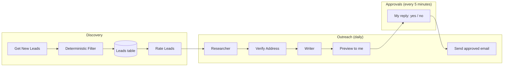
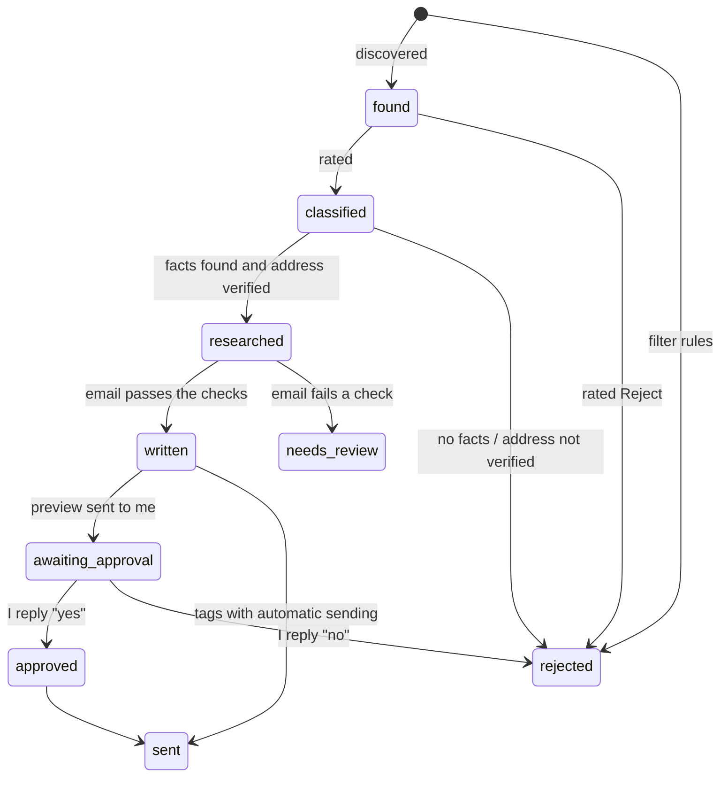

# AI Job Hunter

An n8n automation that finds companies that could use an automation engineer, researches them, writes each one a short personal email, and sends it only after I approve it.

I built it for my own job search. If you received an email from it: hello! This is how it works. Reply to that email and you will be talking to me, not to the automation.

## What it does

1. **Finds companies.** An AI model with web search looks for small and medium companies in a sector and region picked at random from a list.
2. **Filters them.** Plain code rejects job boards, social networks and anything without a real website, before any more AI money is spent.
3. **Rates them.** A cheap model rates each company as High, Medium, Low or Reject.
4. **Researches the best ones.** For the top leads, up to a daily quota, a model reads the company's own website and writes down facts, each with the page it came from.
5. **Verifies the address.** The workflow downloads the exact page the model cited and checks that the email address is really written there. An address the model cannot prove is never used.
6. **Writes the email.** A better model writes a short email in my voice, using only the verified facts and my real experience, in Spanish or English.
7. **Checks the email.** Code checks the length, the register, leftover placeholders and lists. A failed email is held for review, never sent.
8. **Asks me.** I receive a preview with the CV attached. I reply "yes" or "no".
9. **Sends and remembers.** Approved emails are sent. Every company is stored, so nobody is contacted twice.

## The workflows

| File | Workflow | What it does |
|---|---|---|
| `01-discovery.json` | Discovery | Finds, filters, deduplicates, stores and rates leads. |
| `02-get-new-leads.json` | Get New Leads | Asks a search model for new companies. |
| `03-deterministic-filter.json` | Deterministic Filter | Rules in code: website, company domain, language, usable address. |
| `04-rate-leads.json` | Rate Leads | Rates each lead and validates the rating. |
| `05-outreach.json` | Outreach | Daily run: picks leads within the quota, researches, writes, previews and sends. |
| `06-researcher.json` | Researcher | Collects facts about one company, with sources. |
| `07-verify-address.json` | Verify Address | Downloads the cited page and checks the address is on it. |
| `08-writer.json` | Writer | Writes and checks the email. |
| `09-approvals.json` | Approvals | Reads my "yes" / "no" replies and updates the lead. |

## How a lead moves

Every lead lives in one Data Table row. Its `status` says where it is, and every workflow only picks up leads in the status it is responsible for, so a crashed run simply continues next time.

## Safety design

- **No invented addresses.** The address must be written on a page the workflow downloads itself. The model's word is not enough.
- **No invented claims.** The writer may only use the verified company facts and the rows of the Experience table.
- **Web content is data.** Every prompt tells the model to ignore instructions found inside web pages.
- **Safe downloads.** Verify Address only fetches normal public pages: no internal or numeric addresses, no hidden user names in the address, and no redirects.
- **A human approves.** With `automaticEmail` set to `false`, nothing is sent to a company until I reply "yes" to its preview. Replies are only accepted from my own address, inside the thread the workflow started, and only for a lead still waiting for approval.
- **Test mode.** In Outreach, `TEST_MODE = true` sends every email to your own address and marks the lead `test sent` instead of `sent`. It is on in this repository.
- **One contact per company.** Companies are deduplicated by domain against everything already in the table, including rejected and sent ones.
- **Daily quota.** Research stops when the quota is filled by emails that are sent, written or waiting for approval, so it never pays to research leads it will not contact.
- **A failed send is retried, not repeated.** Successful sends are marked one by one, so a failure halfway never causes a second email to the same company.
- **Nothing private in the files.** Credentials stay in n8n, and personal addresses in this repository are placeholders.

## Setup

You need a self-hosted or cloud n8n with Data Tables, an OpenAI credential and a Gmail credential.

1. **Create five Data Tables** and import the example files from `tables/`:
   - **Settings**: `settings.example.csv`. One row per kind of search ("tag").
   - **Leads**: `leads.template.csv` has the columns. It starts empty.
   - **Experience**: `experience.example.csv`. Replace it with your own experience. The writer may only say what is in this table.
   - **English Writing Samples** and **Spanish Writing Samples**: a few paragraphs you wrote yourself, so the emails sound like you.
2. **Import the nine workflows** from `workflows/`.
3. **Reconnect everything.** After import, open each workflow and:
   - select your OpenAI and Gmail credentials,
   - select your tables in every Data Table node,
   - select the right sub-workflow in every Execute Workflow node (identifiers change on import),
   - set an error workflow and the timezone in the workflow settings.
4. **Set your address** (replace `your.address@example.com`) in three places:
   - Outreach → **Prepare Emails** (`MY_ADDRESS`)
   - Approvals → **Read Decision** (`MY_ADDRESS`)
   - Approvals → **Watch Approval Replies** (search query)
5. **Fill in Settings**: your discovery prompt (with `{sector}` and `{region}`), your sector and region lists, links to your CV in each language, your goal, and the optional explanation text added to every email.
6. **Publish Approvals**, so it can read your replies.
7. **Test**: run Discovery, then Outreach, with `TEST_MODE = true` and `automaticEmail` set to `false`. Approve a few previews and run Outreach again.
8. **Go live**: set `TEST_MODE = false`, then add a Schedule Trigger to Discovery and to Outreach and publish them.

## Models

| Stage | Model |
|---|---|
| Rate Leads, Researcher | `gpt-6-luna` (the cheapest) |
| Get New Leads | `gpt-6.1-terra` |
| Writer | `gpt-6.1-sol` |

Most of the cost is web search, not the models. A daily run of a few emails costs cents.

## Limitations

- Addresses hidden by the website (for example behind a script or a login wall) cannot be verified, so those leads are rejected. This is on purpose: a wrong rejection is cheaper than an email to an invented address.
- The email writer only knows Spanish and English.
- Execution order matters in Discovery and Outreach: their branches must stay in the same top-to-bottom order on the canvas (there is a note in each).

## See also

The page about this project on my portfolio is written and kept up to date by another automation of mine, [Living Portfolio](https://github.com/Prolegomeno/living-portfolio).

## License

MIT. See [LICENSE](LICENSE).
